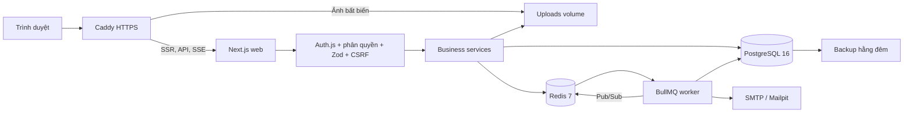

# Kiến trúc

## Ranh giới module

`src/app/api/v1/[...path]/route.ts` điều phối các resource: đọc/parse input, xác thực CSRF, giới hạn tần suất, lấy người dùng, gọi service, chuẩn hóa response. Không nhận role hay authorId từ client. `security.ts` là nơi kiểm tra phiên, trạng thái tài khoản, ownership và role. Prisma chỉ được dùng trực tiếp ở SSR cho truy vấn đọc, hoặc trong service cho nghiệp vụ ghi.

`accounts`, `stories`, `social`, `notifications`, `discovery`, `counters`, `analytics`, `storage`, `moderation` chia nghiệp vụ theo miền. `StorageService` có triển khai local và có thể thay bằng S3. `jobs/queue.ts` dùng connection riêng để web và worker chia sẻ hàng đợi. Worker không chạy bên trong web process.

## Xác thực

Auth.js v5 với PrismaAdapter và JWT session hỗ trợ Credentials và Google OAuth. Credentials dùng Argon2id và không tự đánh dấu email đã xác minh. Google chỉ được bật khi có hai biến OAuth. Token email ngẫu nhiên 256 bit chỉ lưu SHA-256, có hạn 60 phút, tiêu thụ một lần trong transaction. `sessionVersion` vô hiệu hóa JWT cũ sau đổi mật khẩu/email/khóa tài khoản. Mọi request đọc phiên kiểm tra trạng thái tài khoản trong DB.

CSRF với cookie HttpOnly SameSite=Strict, token trong header và Origin bằng canonical origin áp dụng cho mọi mutation ngoài Auth.js. Endpoint `/api/csrf` cấp token. Auth.js tự bảo vệ những endpoint của nó. Caddy ghi đè X-Real-IP; web không công khai cổng ngoài proxy. Rate limits và khóa login dùng Redis.

## Viết và xuất bản

TipTap lưu HTML allowlist và plain text để đếm từ/tìm trùng. Autosave PATCH chứa revision. Transaction khóa row chương, so sánh revision, lưu phiên bản trước đó, giữ 30 bản, tăng revision. Client giữ bản chưa lưu trong bộ nhớ và localStorage theo user/chapter, retry khi online, chặn đóng tab khi dirty. Xung đột không tự ghi đè: cho xuất HTML, người dùng xử lý bản mới.

Chỉnh sửa nội dung chương đang xuất bản đưa chương về nháp. Xuất bản kiểm tra từ cấm, mật độ URL và hash nội dung khác tác giả. Nội dung bị gắn cờ chuyển REVIEW và tạo report. Moderator có thể phê duyệt. Scheduled job kiểm tra lại trạng thái và thời điểm để job cũ không xuất bản nhầm. Reconciler mỗi phút khôi phục lịch hẹn bị lỡ hoặc lỗi enqueue. Worker gửi thông báo chương với unique eventKey để retry không tạo bản trùng.

## Đọc và đếm lượt đọc

SSR luôn lọc published/deleted/hidden/trạng thái tác giả và độ tuổi. HTML được lọc lại khi render. Lượt đọc POST xác nhận chương đang truy cập được, sau đó Lua SET NX + HINCRBY nguyên tử khử trùng `(user hoặc IP-hash, chapter)` trong 30 phút. Không UPDATE PostgreSQL theo page view.

Mỗi phút, worker đổi tên hash pending thành batch và đăng ký batch trong Redis atomically. Transaction PostgreSQL insert `CounterBatch` với unique ID, tăng counters và daily aggregates. Sau commit mới xóa batch Redis. Crash sau commit vẫn an toàn vì ledger chống cộng hai lần. Redis AOF và `noeviction` bảo vệ queue/counter khi khởi động lại.

## Thông báo và xã hội

Vote/follow/library có composite primary key, API đặt trạng thái mong muốn để retry idempotent. Bình luận giới hạn một cấp trả lời, dùng cursor, chống trùng nội dung gần đây, giới hạn URL. UI optimistic rollback khi lỗi. NotificationPreference lọc từng loại; DB lưu lịch sử, Redis Pub/Sub báo refresh, SSE truyền tới browser, polling 30 giây dự phòng. SSE đóng sau 5 phút để reconnect kiểm tra lại session. Digest hằng ngày chỉ gửi notification CHAPTER chưa gửi trong 7 ngày; có tùy chọn tắt.

## Tìm kiếm, xếp hạng và cache

Migration tạo `unaccent`, `pg_trgm`, hàm immutable, search_vector và trigger cập nhật khi sửa title/description/thẻ. Trọng số A/B/C tương ứng title/tags/description; truy vấn dùng websearch_to_tsquery, ts_rank_cd, similarity và ILIKE không dấu. Mọi giá trị SQL được parameterize. Prisma áp dụng bộ lọc quyền truy cập trước phân trang.

Worker tính Redis sorted sets hôm nay/tuần/tháng/mọi thời đại mỗi 10 phút. Công thức: `(reads + votes × 8 + comments × 5) / (ageHours + 2)^1.35`; mọi thời đại không giảm theo tuổi. Trang chủ cache dữ liệu công khai an toàn 60 giây bằng unstable_cache, invalidate tag khi web sửa/xuất bản. Worker cập nhật được nhìn thấy tối đa sau 60 giây. HTML SSR sử dụng nonce CSP, nên không cache toàn trang cá nhân hóa; các truy vấn công khai được cache riêng. Upload tên ngẫu nhiên bất biến có cache 1 năm.

## Vận hành

Compose: web standalone, worker Node, Postgres, Redis, Caddy, backup, Mailpit dev profile. Prisma pool 10 connection/process; 100 connections của Postgres phù hợp quy mô thử nghiệm. `/api/health` kiểm tra DB và Redis; worker dùng heartbeat. Pino log có redaction. SENTRY_DSN tùy chọn gửi sự kiện lỗi tối thiểu không đính kèm body/token/người dùng. Thùng rác được xóa vĩnh viễn sau 30 ngày, email token hết hạn dọn mỗi đêm, thông báo đã đọc giữ tối đa 180 ngày.
